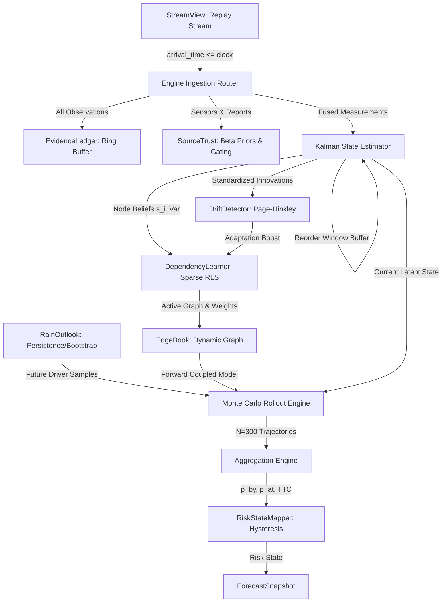

# The 72-Hour Warning: Forecaster Technical Specification (Phase 2)

> **Role:** Phase 2 turns the replayed observation stream into continuously revised, multi-horizon, probabilistic risk forecasts with learned dependencies, source trust, and drift handling.
> **Calibration Status:** Raw uncalibrated probabilities (`calibrated=false`). Calibration, baselines, and formal metrics are Phase 3.

---

## 1. System Architecture & Information Flow

The Forecaster operates in a closed-loop online streaming architecture consuming exclusively a `StreamView` (strictly `arrival_time <= clock_time`).

---

## 2. Core Mathematical Formulations

### 2.1 State Estimation and Late-Arrival Filtering (Estimator)
Each node $i = (\text{zone}, \text{system})$ maintains a Gaussian belief state $(\hat{s}_i, \sigma_i^2)$ over its continuous stress $s_i \in [0, 1]$.
- **Time Predict Step:**
  $$\hat{s}_i(t \mid t-1) = \hat{s}_i(t-1)$$
  $$\sigma_i^2(t \mid t-1) = \sigma_i^2(t-1) + Q_i$$
  where $Q_i$ is process noise variance (default $0.005$).
- **Multi-Source Precision Fusion:**
  When multiple observations arrive for the same node and hour, measurements $y_{i, k}$ with source trust $r_k \in (0, 1]$ are fused by trust-weighted precision:
  $$\sigma_{obs, k}^2 = \frac{\sigma_{meas}^2}{r_k}$$
  $$\tau_{fused} = \sum_k \frac{1}{\sigma_{obs, k}^2}, \quad y_{fused} = \frac{1}{\tau_{fused}} \sum_k \frac{y_{i, k}}{\sigma_{obs, k}^2}$$
- **Kalman Measurement Update:**
  $$K_i = \frac{\sigma_i^2(t \mid t-1)}{\sigma_i^2(t \mid t-1) + \tau_{fused}^{-1}}$$
  $$\hat{s}_i(t \mid t) = \text{clip}\left(\hat{s}_i(t \mid t-1) + K_i (y_{fused} - \hat{s}_i(t \mid t-1)), 0, 1\right)$$
  $$\sigma_i^2(t \mid t) = (1 - K_i) \sigma_i^2(t \mid t-1)$$
- **Late Arrivals & Reorder Buffer:**
  Observations carry `event_time <= arrival_time`. A ring buffer of the last `reorder_window_hours` (24h) is maintained. When an observation arrives out of order, the filter is rolled back and re-evaluated deterministically from the earliest affected hour. Older observations are accepted into the ledger but not re-filtered.

### 2.2 Source Trust, Outlier Gating & Evidence Quality
- **Beta Reliability Posteriors:** Each source $k$ maintains $\text{Beta}(\alpha_k, \beta_k)$, initialized from config (`prior_alpha=4, prior_beta=1`). Sources are updated only when at least 2 independent sources observe the same node at the same hour. Agreement with leave-one-out peer consensus adds to $\alpha$; large standardized residual ($z > \text{outlier\_z}$) adds to $\beta$.
- **Outlier Gating:** Observations with standardized innovation $|y - \hat{y}| / \sigma > \text{outlier\_z}$ against both current model prediction and peer sensors are flagged `gated` in the ledger and excluded from state updates.
- **Flatline Detector:** Identical sensor values for $\ge \text{flatline\_hours}$ (default 6h) are flagged as stuck-at sensors, zeroing information gain and inflating observation variance.
- **Citizen Report Corroboration:** Citizen reports count as weak evidence only when corroborated by $\ge \text{min\_corroborators\_for\_reports}$ (2) distinct reports and consistent with sensor stress. Otherwise, their weight is capped at `report_weight_cap` (0.3) or zero.
- **Evidence Quality Formula:**
  $$\text{EQ}_i = 0.40 \cdot \text{Freshness}_i + 0.35 \cdot \bar{r}_i + 0.25 \cdot \text{Agreement}_i$$
  where:
  - $\text{Freshness}_i = \exp(-\Delta t_{obs} / 24)$ is observation recency.
  - $\bar{r}_i$ is the mean trust of contributing sources.
  - $\text{Agreement}_i = 1 - \min(1.0, \text{residual} / 0.5)$.

### 2.3 Online Dependency Learning & Graph Dynamics
The continuous node dynamics follow:
$$s_i(t+1) = \text{clip}\left( a_i + \rho_i s_i(t) + \sum_{j, \tau} w_{ji, \tau} s_j(t+1-\tau) + \sum_k \beta_{ik} f_k(t) + \epsilon_i, 0, 1 \right)$$
where:
- $\rho_i \in [0, 1]$ is autoregressive persistence.
- Candidate parents are restricted to: (1) other systems in the same zone, (2) same system in adjacent zones, (3) hydrologically upstream links from `river_links`, and (4) weak prior edges.
- **Recursive Least Squares with Forgetting:**
  $$P_t = \frac{1}{\lambda} \left[ P_{t-1} - \frac{P_{t-1} x_t x_t^T P_{t-1}}{\lambda + x_t^T P_{t-1} x_t} \right]$$
  $$\theta_t = \theta_{t-1} + P_t x_t (y_t - x_t^T \theta_{t-1})$$
  with forgetting factor $\lambda = 0.995$, regularized toward domain prior with ridge parameter $\gamma = 1.0$.
- **Edge Sparsification & Hysteresis:** Edges require $|z| \ge z_{min} = 2.0$ and $|w| \ge w_{min} = 0.02$. An edge must maintain significance for `edge_hysteresis_steps` (6) consecutive hours to become active, preventing edge flickering.
- **Label Maturity (Rule 3):** One-step learning targets $s_i(t)$ are updated only when clock $\ge t$. 72-hour targets are never used for online updates.

### 2.4 Concept Drift Detection
- Node-level standardized one-step prediction errors $e_i(t) = (y_i(t) - \hat{s}_i(t)) / \sigma_i$ are monitored by a Page-Hinkley cumulative sum detector:
  $$m_t = \bar{e}_t, \quad U_t = \sum_{k=1}^t (e_k - m_k - \delta), \quad m_t = \min_{1 \le k \le t} U_k$$
  $$\text{PH}_t = U_t - m_t > \lambda_{PH}$$
- When drift fires: adaptation rate is boosted for `boost_hours` (24h) by reducing forgetting factor to $\lambda_{boost} = 0.97$, coefficient covariance is inflated, and affected edges carry reduced confidence.

### 2.5 Rain Outlook Models & Precursor Mechanics
To obey Rule 2 (No Future Rain), rollouts draw future precipitation only from models fitted on past observations:
1. **PersistenceDecayOutlook:** Exponential decay of recent 6-hour mean intensity toward climatological mean with stochastic bursts.
2. **BlockBootstrapOutlook:** Resamples blocks of historical hourly rain from the zone's past record, conditioned on current rain intensity regime.
3. **OracleOutlook (Diagnostic Lockout):** Returns ground truth future rain. Strictly gated: throws RuntimeError unless environment variable `FORECAST_ALLOW_ORACLE=1` AND `diagnostic=True` are both set. Marked `oracle=true` in output.
- **Soil Moisture in Rollouts:** Soil moisture evolves via causal antecedent precipitation decay:
  $$\text{soil}(t+1) = \text{clip}\left( \text{soil}(t) \cdot e^{-1/168} + 0.005 \cdot \text{rain}(t), 0, 1 \right)$$

---

## 3. Monte Carlo Cascade Engine & Aggregation

### 3.1 Vectorised Rollout Engine
- Runs $N = 300$ futures over 72 hourly steps simultaneously using NumPy array tensorization:
  - State tensor: `S[N, num_nodes]`
  - Ring buffer for candidate lags: `history[max_lag, N, num_nodes]`
  - Random draws generated via `NoiseBank` using `np.random.SeedSequence(seed)` for common random numbers (enabling clean Phase 3 counterfactual intervention comparisons).
- **Sub-Second Performance:** Benchmarked at **7.3M node-steps/sec** ($0.177$ seconds for 60 nodes $\times$ 72 hours $\times$ 300 rollouts), easily satisfying interactive replay requirements.

### 3.2 Probabilistic Aggregations & Censoring
- **Cumulative vs Instantaneous:**
  - $p\_by[h][\text{state}] = P(\text{node reached } \ge \text{state at any time } \le h)$ (monotonically non-decreasing in $h$).
  - $p\_at[h][\text{state}] = P(\text{node is } \ge \text{state at time } h)$.
  - Axiom: $p\_by[h][\text{state}] \ge p\_at[h][\text{state}]$.
- **Time-to-Critical (TTC) with Censoring:**
  - First-passage crossing times $t^* = \min \{ t \mid s_i(t) \ge \text{critical} \}$, with $t^* = +\infty$ if never reached within 72h.
  - $p\_no\_critical\_within\_72h = P(t^* = +\infty) = 1 - p\_by[72][\text{critical}]$.
  - Unconditional quantiles (10th, 50th, 90th) evaluate to `null` if the quantile falls in the censored mass.

### 3.3 Zone & City Cascade Rules
- **Zone Level:** Computed across rollout realizations preserving spatial and cross-system covariance:
  - $\text{Zone HIGH\_RISK}$: Any system in the zone reaches $\ge 0.60$ stress.
  - $\text{Zone CRITICAL}$ (True Cascade): At least `zone_cascade_min_systems` (2) distinct infrastructure systems simultaneously reach critical stress ($\ge 0.80$). Isolated single-asset failure does not trigger zone critical.
- **City Level:**
  - $\text{City CRITICAL}$: At least `city_zone_fraction` (0.20) of zones are concurrently in cascade-critical status.

---

## 4. Provenance Breakdown: Real vs. Simulated Streams

| Stream Domain | Source / Data Lineage | Classification | Provenance Disclosure |
| :--- | :--- | :--- | :--- |
| **Rainfall** | Open-Meteo ERA5 Reanalysis / GPM IMD | **REAL** | Replayed historic rain with hourly causal latency |
| **Soil Moisture** | Open-Meteo Volumetric Soil Layer 1 | **REAL** | Replayed historic soil wetness |
| **Geography & Zones** | OpenStreetMap Boundary Relations | **REAL** | True Assam district boundaries & topological neighbours |
| **River / Embankment** | Hydrological lag model driven by real rain | **SIMULATED** | Rain-driven synthetic river levels & flood stage |
| **Power Distribution** | Coupled infrastructure model | **SIMULATED** | Substation outage & grid failure simulation |
| **Transport / Roads** | Coupled infrastructure model | **SIMULATED** | Roadway inundation & highway cutoffs |
| **Telecommunications** | Coupled infrastructure model | **SIMULATED** | Cellular tower loss & traffic overload |
| **Healthcare Facilities** | Coupled infrastructure model | **SIMULATED** | Hospital inundation & ICU backup generator stress |
| **Emergency Response** | Coupled infrastructure model | **SIMULATED** | NDRF/SDRF rescue boat and crew capacity exhaustion |
| **Citizen Reports** | Stochastic event generator | **SIMULATED** | Crowdsourced reports with injected noise & spam |

---

## 5. Critical Domain Limitation: The Assam Sub-Step Surge

> [!WARNING]
> **Sub-Step Hydrological Surge Reality:**
> Analysis of the 2026 Upper Assam event indicates that runoff surges from the steep Nagaland hill catchments (Dikhow, Disang, Dhansiri river headwaters) can reach plain embankments in as little as **90 minutes** (opinion analysis, not an official gauge record).
> 
> Because the simulation engine operates on **1-hour discrete time steps**, a 90-minute surge provides fewer than 2 simulation ticks between border entry and plains impact.
> 
> **Scientific Integrity Notice:**
> The Forecaster does **not** claim to predict flash-flood surges from the hydrograph crest itself. Rather, genuine 24–72h predictive early warning comes from **precursors**:
> 1. Multi-day antecedent rainfall accumulation (rolling 24h, 72h, 168h rain sums).
> 2. Antecedent soil moisture saturation ($> 0.38 \text{ m}^3/\text{m}^3$) reducing infiltration capacity.
> 3. Sustained upstream precipitation in hill catchment zones (`mon_nl`, `mokokchung_nl`, `wokha_nl`) lagged by $12\text{h}$ to $24\text{h}$.

---

## 6. How Technical Playbook Requirements Are Addressed

| Playbook Requirement | Status in Phase 2 | Concrete Implementation | Deferred to Phase 3 |
| :--- | :--- | :--- | :--- |
| **1. Multi-horizon forecasting & TTC** | **Complete** | Vectorized Monte Carlo rollouts (1h, 3h, 6h, 12h, 24h, 48h, 72h); $p\_by$, $p\_at$, and censored TTC quantiles. | Isotonic probability calibration & reliability curves. |
| **2. Dependency discovery** | **Complete** | Online RLS with forgetting factor $\lambda=0.995$; candidate parent pruning; edge hysteresis; `EdgeBook` with full change audit log. | Graph structure accuracy scoring against planted truth. |
| **3. Cascade prediction** | **Complete** | Coupled multi-asset forward model; simultaneous trigger synergy; feedback loops with non-divergence clipping. | Counterfactual intervention do-calculus. |
| **4. Continuous learning under drift** | **Complete** | Page-Hinkley change detector; adaptation boost window; dynamic variance inflation. | Multi-regime benchmark comparisons. |
| **5. Uncertainty & adversity** | **Complete** | Beta source reliability; outlier gating; stuck-at flatline filter; citizen report corroboration; graceful degradation. | Chaos engineering UI test panel. |
| **6. Causal explainability** | **Complete** | `EvidenceLedger` tracking every obs ID; machine-readable `cascade_summary` with dominant parent attribution. | Explanatory user interface & natural language summaries. |
| **7. Interventions** | **Hook Provided** | `rollout(..., intervention=...)` parameter patch hook in place. | Action catalog, knapsack optimization, counterfactual delta reporting. |
| **8. Generalization to unseen cities** | **Complete** | Fully configuration-driven (`upper_assam.yaml`, `north_bank_assam.yaml`); dynamic zone and node counts. | Multi-city cross-evaluation benchmarks. |
| **9. Temporal validation & leakage** | **Complete** | Canary test T1 bit-for-bit identical; import scan T2; label maturity T3; causal normalization T4. | Lead-time vs false-alarm curves, Brier score, ECE. |
